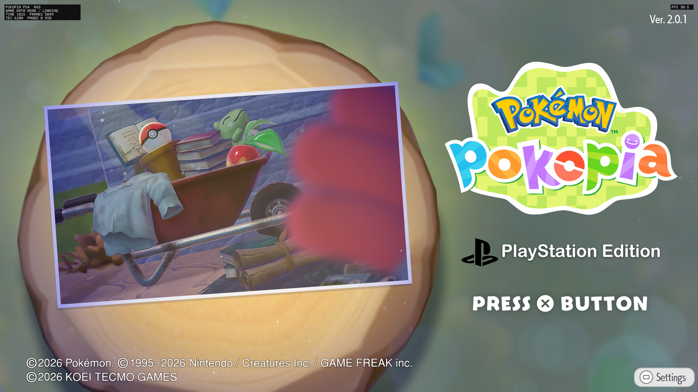
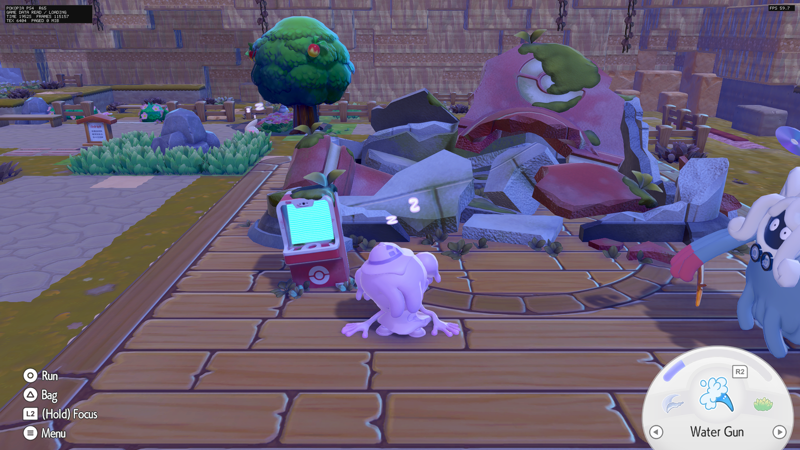
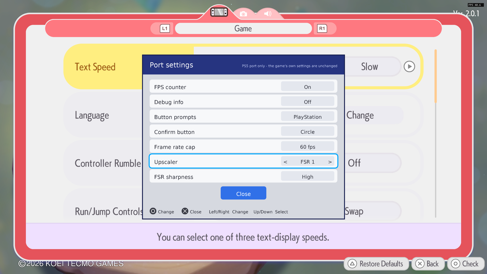

# Pokémon Pokopia on PS5

Unofficial, fan-made PS5 port of Pokémon Pokopia, built on the static recompilation from
[Pokopia Recomp](https://github.com/drakolordx7/pokopia-recomp). The Windows builder creates a PS5
homebrew title from your own copy of the game. See [LEGAL.md](LEGAL.md).

[Download PokopiaPS5Builder.exe](https://github.com/CallMeBrado/Pokopia-PS5-Recomp/releases/latest/download/PokopiaPS5Builder.exe)
· [Latest release and notes](https://github.com/CallMeBrado/Pokopia-PS5-Recomp/releases/latest)



## Features

- Gameplay with save and load support. Tested outdoor scenes ran at about **60 FPS** after loading.
- **52.6 seconds to the title screen** in the v1.0.1 PS5 test, down from 54.9 seconds on the previous
  build. The update uses native decompression for supported assets.
- **120 Hz video output** on compatible displays and a selectable **30 FPS, 60 FPS, or Uncapped** frame
  rate. Some game systems run faster in Uncapped mode because they assume a 60 FPS limit.
- **DualSense controls** with rumble, PlayStation button prompts, and a light bar that changes color
  during supported Pokémon conversations. Text entry uses an on-screen keyboard.
- **FSR 1 or bilinear upscaling**, adjustable FSR sharpness, and optional FPS and debug overlays.
- **Standalone Windows builder** with automatic home-screen icon selection, a built-in fallback, and
  a custom image option. Export a folder, an exFAT image, a UFS2 image, or upload directly to the PS5 over FTP.



## Install and run

### 1. Check the requirements

- **Windows 10 or 11, 64-bit.** Allow about 45 GB of free space for temporary files on an NTFS drive,
  plus space for the exports you select. The finished title folder is about 15 GB. The first build
  needs an internet connection to download build tools.
- **Your own extracted Pokémon Pokopia 2.0.1 dump, update 655360.** Select the directory that contains
  `base` and `updates`. The update's `exefs` should contain the decrypted NSOs, and `romfs` should
  contain the extracted files, including `LI_C0_R.IDX`.
- **A PS5 already set up for homebrew**, with etaHEN and ShadowMountPlus available. See the
  [ShadowMountPlus scan paths and image formats](https://github.com/PSBrew/ShadowMountPlus#scan-paths).

The dump should use this folder layout.

```text
Pokopia dump/
├── base/
└── updates/
    └── 655360/
        ├── exefs/
        └── romfs/
```

### 2. Run the Windows builder

1. Download `PokopiaPS5Builder.exe` and double-click it. The standalone EXE unpacks its supporting
   files the first time you open it.
2. Select your **Pokopia dump** and a **Local output folder**. Choose an NTFS location under
   **Temporary files** if you want the build to use a different drive.
3. Choose your export under **Export as**. Leave the icon set to **Automatic** to use the icon from
   your dump if available, or select **Choose…** to use your own image.
4. Select **Build**. The first build usually takes one to three hours, mostly to translate shaders.
   If you select **Stop**, use the same folders and select **Build** to resume. Use **Keep the
   intermediate files** to speed up later rebuilds.

### 3. Install the result and launch it on PS5

- **Folder.** Copy the entire `PPSA94010` folder to `/data/homebrew/` so `eboot.bin` is at
  `/data/homebrew/PPSA94010/eboot.bin`.
- **exFAT or UFS2 image.** Copy `PPSA94010.exfat` or `PPSA94010.ffpkg` to a ShadowMountPlus scan
  location, such as the root of a USB drive connected to the console.
- **FTP.** Start the FTP server on your PS5 and enter the console's IP address in the builder before
  selecting **Build**. Use `IP:port` if your server uses a port other than `2121`. The builder
  uploads the title to `/data/homebrew/PPSA94010`.

Run ShadowMountPlus with your homebrew environment active. Once the title appears, launch Pokopia
from the PS5 home screen.

### Update an existing installation

Close the game, rebuild it with the latest Windows builder, and install the rebuilt output. For a
folder or FTP update, move the old `PPSA94010` folder outside the scanned locations first. FTP
requires the destination to be free. For an image update, replace the old image in your scan location.
Saves are stored separately at `/data/pokopia/save-r40`. Back up that directory before updating.

## Port settings

Hold the DualSense touchpad for about one second to open **Port settings**. A tap opens the game's
settings. The port menu lets you switch between PlayStation and Nintendo prompts, use Circle or Cross
for confirm, adjust the frame limit and upscaler, and toggle the FPS and debug overlays. The port
saves these options at `/data/pokopia/port-settings.ini`.



## Developer build

The port runs locally recompiled game code on the PS5 CPU. The [Horizon service layer](horizon/)
implements the Switch services the game uses, and the [NVN-to-Vulkan bridge](gfx-bridge/) replays
commands on the PS5 [RADV driver](https://github.com/mihawk-99/PS5_Vulkan).

The manual build uses WSL Ubuntu, the PS5 payload SDK, and the PS5_Vulkan RADV archive. See
[`setup-build-host.sh`](ps5/scripts/setup-build-host.sh) and [`env.sh`](ps5/build/env.sh) for the
build environment. Recompile your own dump and generate the shader cache, then run
`ps5/build/compile-game.sh`, `ps5/build/compile-runtime.sh`, and `ps5/build/link-title.sh` to produce
`ps5/dist/PPSA94010`.

See the [builder workflow](.github/workflows/builder.yml), [performance notes](docs/PS5_60FPS_PLAN.md),
and [original port plan](docs/PS5_PORT_PLAN.md) for details.

## License

GPL-3.0-or-later. See [LICENSE](LICENSE) and [third-party licenses](THIRD_PARTY.md).
